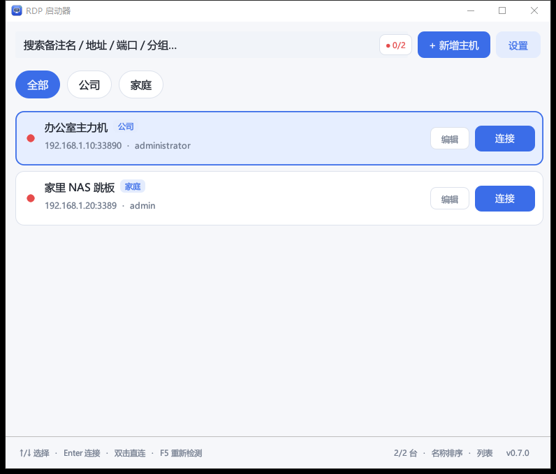
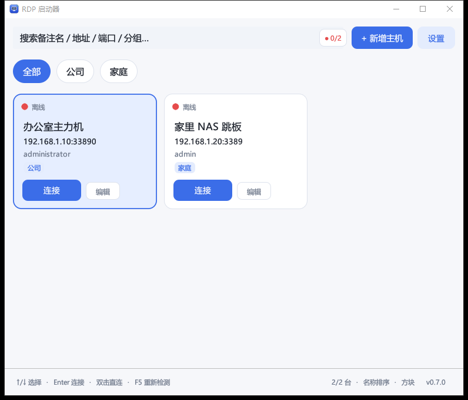
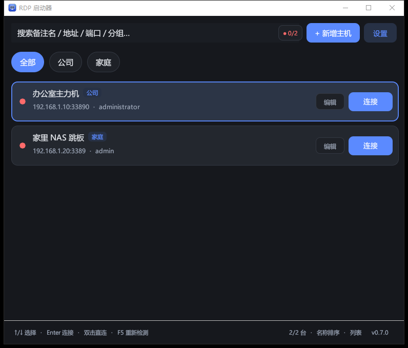
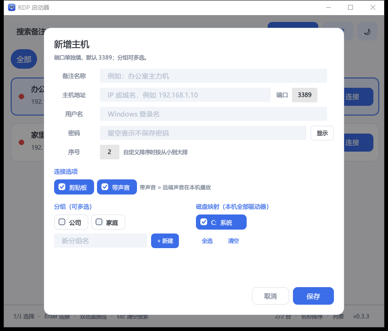
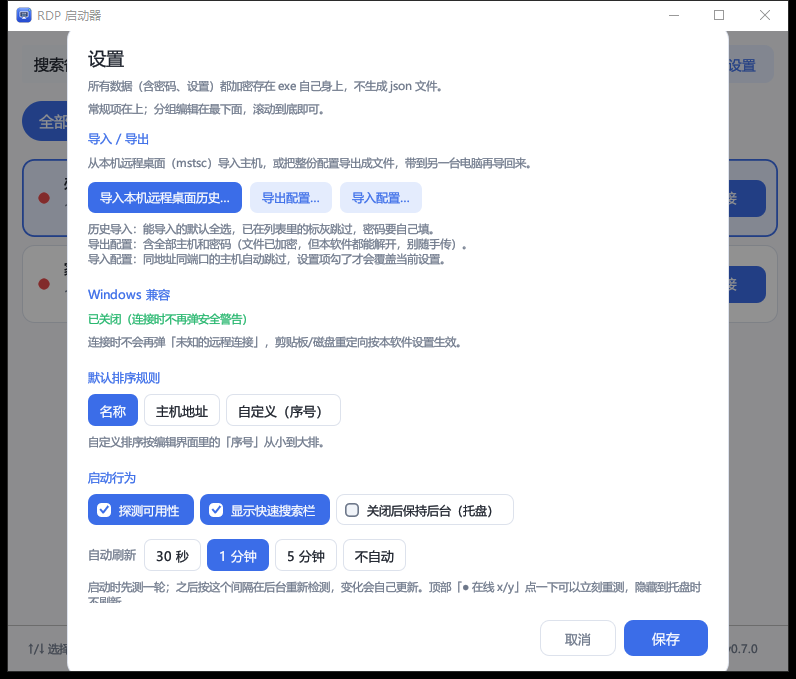
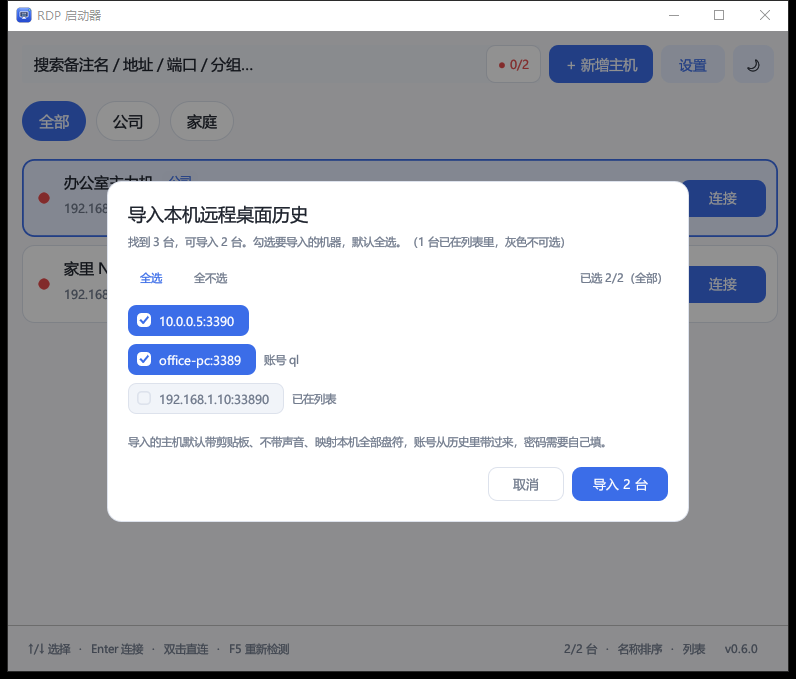
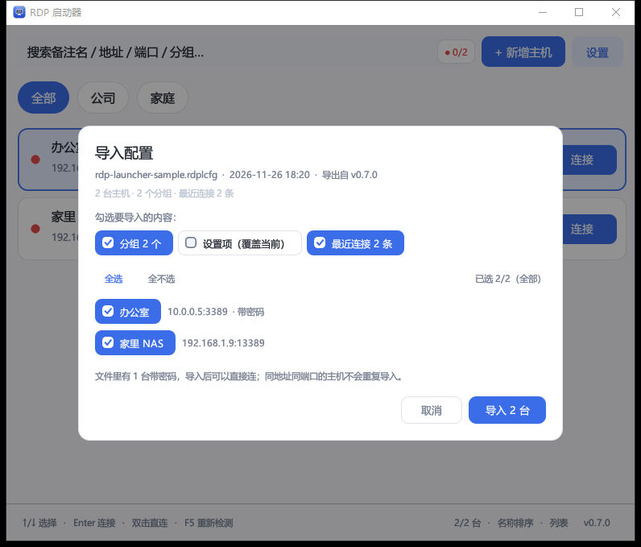
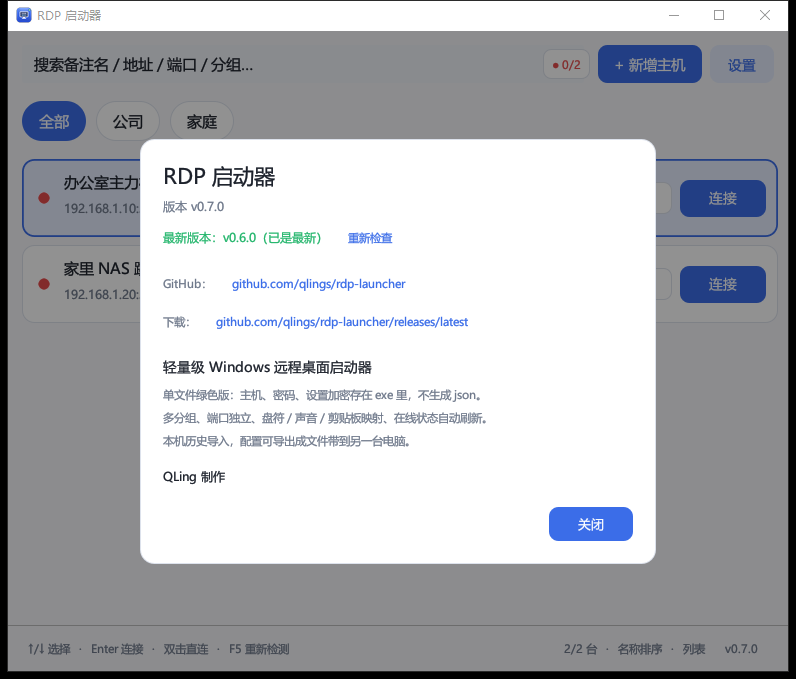

# RDP 悬浮启动器

Windows 专用的极速轻量级远程桌面启动器。绿色免安装，双击即用，不装服务、**不在旁边生成 json 文件**
（为了压掉 Windows 的 RDP 安全警告，会写少量 HKCU 项；关闭「未知的远程连接」需要一次性写 HKLM 策略，
详见下文）。

```
rdp-launcher.exe      # 单文件，主机、密码、设置都在里面
```

## 下载

- **成品**：到 [Releases](https://github.com/qlings/rdp-launcher/releases/latest) 下载 `rdp-launcher.exe`
  （约 4 MB，单文件，免安装）。
- **软件渲染补丁**：只有 OpenGL 1.1 的机器（远程桌面会话、无显卡驱动）再下载
  `mesa-software-render.zip`，把里面两个 dll 解压到 exe 旁边即可。
- **源码**：`git clone https://github.com/qlings/rdp-launcher.git`

## 截图

| 列表 | 方块 | 深色 |
|---|---|---|
|  |  |  |

| 新增主机 | 设置 | 导入本机历史 |
|---|---|---|
|  |  |  |

| 导入配置 | 关于 |
|---|---|
|  |  |

## 功能

- **新增 / 编辑主机**：主机地址和端口分开填，端口默认 `3389`；支持 IPv4、域名、IPv6。
  主机地址框可以直接粘贴 `192.168.1.10:33890` / `rdp.example.com:13389` / `[fe80::1]:3390`，
  自动把端口拆到右边端口框。
- **输入框占位词**：淡灰色，不抢正文；已保存主机的密码为空时不再显示「留空…」提示。
- **多分组**：一台主机可以同时属于多个分组；分组可改名、调顺序、设默认，启动时先展示默认分组。
- **排序**：默认按名称 / 主机地址 / 自定义（编辑里的「序号」）排序。
- **显示方式**：紧凑列表，或每台主机一张大方块卡片。
- **连接选项**：每台主机单独设置剪贴板、声音、磁盘映射。
- **磁盘映射**：启动时枚举本机所有可重定向驱动器（本地盘、可移动盘、网络盘、有介质的光驱），不再只写死 C/D。
- **快速搜索栏**：可关闭；按备注名 / 地址 / 端口 / 分组 / 用户名模糊过滤。
- **可用性探测**：可关闭；只做 TCP 端口探测（不发密码、不登录）。启动时测一轮，之后按设置里的
  30 秒 / 1 分钟 / 5 分钟自动刷新；顶部 `● 在线 x/y` 胶囊点一下、或按 `F5` 立刻重测。
  同一地址+端口的副本只连一次，结果共用；刷新时旧圆点先留着，不会整排闪灰。
- **双击直接连接**：列表行或方块卡片双击即连；行上只保留「连接」「编辑」。
- **删除防误触**：删除按钮收进编辑界面，二次确认。
- **复制主机**：编辑界面里点「复制一份」，原样复制一台主机（地址、端口、账号、密码、
  分组、盘符、开关、序号全保留），名字后面自动加「副本」；重名自动接 2、3……
  复制品插在原主机下面，改完不用重新填一遍。
- **导入本机历史**：设置最上面的「导入本机远程桌面历史…」，把 mstsc 连过的机器列成一张清单，
  能导入的默认全选、可多选，已经在列表里的标灰跳过；确认后才落库。列表为空时首页上也有这个入口。
- **导出 / 导入配置**：设置 → 导入 / 导出。把全部配置（主机**含密码**、分组、设置项、最近连接）
  写进一个加密的 `.rdplcfg` 文件，换台电脑选这个文件再导回来；导入前先列出内容让你勾
  （主机逐台勾、分组 / 设置项 / 最近连接按类别勾），导入是合并，同地址同端口自动跳过。
- **默认值**：新增 / 导入的主机默认带剪贴板、不带声音、映射本机全部盘符。
- **关闭后保持后台**：默认关闭；开启后关窗口只隐藏主界面，任务栏通知区域留一个小图标。
- **托盘右键菜单**：只列最近用过的 3 台（点一下直接连）/ 打开主界面（全部主机）/ 退出。
- **右下角版本号**：点开「关于」，看软件说明、GitHub 仓库 / 下载地址（可点击）、
  最新版状态（自动查 GitHub，旁边可「重新检查」）和 `QLing 制作`。
- **Windows 安全警告一键关闭**：新版 Windows 打开带重定向的 `.rdp` 会弹「未知的远程连接」；程序内置官方策略开关，管理员授权一次永久关闭。
- **图标 / 版本信息 / DPI 清单**：都嵌在 exe 里。

## 性能

开发机是断开的 RDP 会话（只能走 Mesa 软件渲染），冷/热启动差得比较明显：

| 阶段 | 耗时 |
|---|---|
| 窗口出现（热启动） | ~75–105 ms |
| 窗口出现（冷启动，首次读 61MB Mesa dll） | ~270 ms |
| 启动器自身初始化（字体 9.4ms + 配置解密 1.4ms + 注册表 0.45ms + 盘符 0.35ms） | ~12 ms |
| 连接远程桌面（mstsc 自己启动到出窗口） | ~520–570 ms |

几处刻意的设计：

- **盘符枚举不碰网络**：启动只查盘符 + 类型，网络盘卷标由后台线程补，掉线的网络盘不会把启动卡住。
- **注册表批量写不在启动路径上**：每台主机的 `LocalDevices` 标志丢后台线程。
- **列表虚拟化 + 按需重排**：只画视口里的行；搜索/分组/主机没变就不重排（每帧不再排两遍），
  行循环也不再整份复制可见下标。
- **探活只做该做的**：同地址+端口只连一次；改一台主机只重测那一台；
  隐藏到托盘不刷新；有旧结果时刷新不清空圆点（少一次整排重绘）。
- **托盘图标懒创建**：不开「关闭后保持后台」就完全不建托盘。
- 连接走 `CreateProcessW` 直接拉起 `mstsc.exe`，不经 Shell 文件关联。

## 存储：数据在 exe 自己身上

程序不会生成 `rdp_hosts.json`。存储分两层，启动时取 revision 更大的那份：

1. **运行时**：写在 exe 的 NTFS 数据流 `rdp-launcher.exe:rdp-launcher.cfg`。
   正在运行的 exe 本体被 Windows 锁定、不能改字节，但数据流可以正常读写，所以每次保存都即时生效。
2. **正常退出时**：派生一个临时 helper（本 exe 的副本），等主进程退出、exe 解锁后，把同一份
   密文追加到 exe **字节尾部**。这样压缩、拷到 U 盘、发给别人，数据都跟着 exe 走。

格式：`[AES-256-GCM 密文][u32 长度][16 字节 MAGIC]`。主机、密码、分组、设置整包加密，
密钥由固定口令派生并编进程序——目标是「磁盘上不是明文 + 换机可解开」，不是抗逆向。

**使用注意**

- 需要把 exe 放在 **NTFS** 磁盘上；FAT32/exFAT 不支持数据流，程序会显示红色错误条，不会静默丢数据。
- 不要把 exe 放在只读目录。
- 建议**退出软件后**再复制 / 压缩 exe；正常退出后尾部才会写入最新数据。
  开了「关闭后保持后台」时，要右键托盘图标 → `退出` 才算真正退出。
- 用资源管理器复制（NTFS→NTFS）会带上数据流；用 zip / 某些下载工具会丢数据流，但尾部那份还在。
- 旧版 `rdp_hosts.json` 会自动导入并删除，之后不再生成。
- 首次运行会写入两台示例主机（办公室主力机 / 家里 NAS 跳板），可以直接删掉。

## 用法

| 操作 | 效果 |
|---|---|
| `↑` `↓` | 在过滤后的列表里上下移动，自动滚动跟随 |
| `Enter` | 连接当前高亮主机 |
| 双击主机 | 直接连接 |
| `F5` | 立刻重新检测一轮在线状态 |
| `Esc` | 弹窗打开 → 关弹窗；搜索框有字 → 清空（不会最小化窗口） |
| `Ctrl+N` | 新增主机 |
| `Ctrl+F` | 聚焦搜索框（搜索栏打开时） |

顶部：`● 在线 x/y` 状态胶囊（比按钮小一圈，点一下重新检测，悬停看上次检测时间）、`+ 新增主机`、`设置`。
**主题切换只在设置里**（顶部不再放月亮/太阳按钮），少一个抢眼的东西。
分组胶囊加大到 40px 高，方便点。
设置是单页：**导入 / 导出**（导入本机历史、导出配置、导入配置）、**Windows 兼容**、排序、
探测 + 自动刷新间隔、搜索栏、关闭后保持后台、显示方式、**主题**、默认分组在最上面，
**分组编辑**（改名、上下移、删除、设默认）在最下面，滚动到底即可。

## 关闭后保持后台（托盘）

默认**关闭**。在设置 → 常规里勾「关闭后保持后台（托盘）」后：

- 点窗口右上角 `X` 或 `Alt+F4`：收进托盘，进程继续跑，任务栏通知区域出现小图标；
  **主界面完全消失**——任务栏和 `Alt+Tab` 里都不再出现（最小化 + 工具窗口样式 + 移除任务栏按钮，
  这样 eframe 的 update 不会停，托盘事件才能处理）。
- 点**最小化按钮**：就是普通最小化，任务栏按钮留在原处，不收托盘。
- 左键点小图标：重新打开主界面。
- 右键小图标：**最近用过的 3 台主机**（点一下直接连）/ `打开主界面（全部主机）` / `退出`。
  刚连过哪台它就排最前；一台都没连过时按当前排序取前 3 台。主机多了也不会把菜单撑成一张长表。
- 要真正退出、让数据写回 exe 尾部：右键小图标 → `退出`。
- 如果图标被 Windows 收进 `∧` 溢出区，把它拖到任务栏或固定住即可。
- 软件是**单实例**：已经开着一个时再双击，会提示「已经有一个在运行」并退出，
  避免两份配置互相覆盖。

## 关掉 Windows 的「未知的远程连接」警告

Windows 2026 更新后，打开**未签名**、带剪贴板/磁盘重定向的 `.rdp` 会弹：

```
警告：未知的远程连接 / 发布者：未知发布者
```

而且它默认把剪贴板、磁盘等重定向全部取消。官方开关是机器策略：

```text
HKLM\Software\Policies\Microsoft\Windows NT\Terminal Services\Client
    RedirectionWarningDialogVersion = 1
```

写 HKLM 需要管理员。程序启动时会：

1. 写 HKCU 的 `RdpLaunchConsentAccepted=1`，压掉首次打开 `.rdp` 的同意提示（不需要管理员）。
2. 如果本身以管理员运行，直接静默写机器策略。
3. 普通用户：顶部会出现一条提示，点「关闭警告（管理员一次）」→ UAC 点「是」→ 之后永久生效。
   也可以到 设置 → 常规 → Windows 兼容 里点同一个按钮。

关闭后，连接时不再弹这个警告，剪贴板/磁盘/声音按本软件设置生效。
如果公司 IT 用组策略强制新行为（HKLM 写成 0），本程序不会去覆盖，会继续显示提示。

### 旧版「无法识别此远程连接的发布者」也一起关

把 `RedirectionWarningDialogVersion` 回退到 1 后，Windows 可能退回旧版对话框：

```
无法识别此远程连接的发布者。是否仍要连接？
```

程序启动/连接前还会写两个 **HKCU** 值（不需要管理员）：

```text
HKCU\Software\Microsoft\Terminal Server Client
    AuthenticationLevelOverride = 0        # 不再校验服务器证书
HKCU\Software\Microsoft\Terminal Server Client\LocalDevices
    <主机/地址> = 0x6F                     # 等价于每个主机都勾了「不再询问我…」
```

> 代价：`AuthenticationLevelOverride=0` 会关闭 RDP 服务器证书校验。
> 本软件本来就是内网/自建机器用的启动器，请只在信任的网络里使用。
> 如果你需要严格校验证书，删掉这个 HKCU 值，并接受每次的发布者提示。

## 连接时它做了什么

1. **校验地址**：主机字段不接受 `host:port`，端口必须走端口框；支持 `fe80::1` 这类 IPv6，
   写 `.rdp` 时自动补方括号。控制字符一律剔除，防止往 `.rdp` 里注入配置。
2. **写凭据管理器**：`CredWriteW`，TargetName 为 `TERMSRV/<主机>`（不含端口），
   `CRED_TYPE_GENERIC` + `CRED_PERSIST_LOCAL_MACHINE`。不调用 `cmdkey.exe`，没有黑框闪。
   **空密码也会写一条「用户 + 空密码」的凭据**：只有账号没有密码的机器靠它直接登录；
   以前空密码删凭据会让 mstsc 停在密码框，等于连不上。
3. **生成 `.rdp`**：写到 `%TEMP%\rdp_launcher_<id>.rdp`，UTF-16 LE + BOM。
   包含 `full address`、`username`、`redirectclipboard`、`audiomode`（0 带声音 / 2 静音）、
   `drivestoredirect`、`smart sizing`。
4. **拉起 mstsc**：用 `%SystemRoot%\System32\mstsc.exe` 的绝对路径，启动器保持原样（不自动最小化）。

勾了磁盘但连接时该盘不存在 → 自动跳过并在 Toast 里提示，不阻断连接。

## 同一 IP 不同端口 / 域名+端口

**支持。** 主机记录本来就是「主机 + 端口」两个字段，两条记录可以分别是
`10.0.0.5:3389` 和 `10.0.0.5:3390`，`.rdp` 的 `full address` 各自带端口，互不影响。
域名 + 端口也支持，例如 `rdp.example.com:13389`；探活会先做 DNS 解析再连。

**一个系统限制**：Windows 的 RDP 凭据 TargetName 固定是 `TERMSRV/<主机>`，**端口不参与**。
所以同一个 IP 上的两台不同机器（不同端口、不同密码）没法在凭据管理器里同时保存两套密码。
本程序的对策是**每次连接前都重写**当前主机的凭据，保证这一次连接用的是正确密码；
已经连上的会话不受影响。只有断开后原地重连时才可能拿错密码，编辑界面会针对这种情况给出提示。
删除主机时如果发现还有别的主机共用同一个 `TERMSRV/<主机>`，不会删凭据，避免误伤。

## 跑起来需要什么

**正常有显卡驱动的机器**：什么都不用，双击 exe。

**RDP 会话 / 没有 OpenGL 3.0 的环境**：Windows 远程桌面会话只给 `OpenGL 1.1`，
egui 的 glow 后端起不来。把 `software-render\` 里的两个 dll 放到 exe 旁边：

```
rdp-launcher.exe
opengl32.dll            ← 来自 software-render\
libgallium_wgl.dll      ← 来自 software-render\
```

程序检测到这两个 dll 会自动设置 `GALLIUM_DRIVER=llvmpipe` 和 `LIBGL_ALWAYS_SOFTWARE=1`，
不用再手动配环境变量。代价是 CPU 渲染，界面慢一点，功能完整。

## 构建

需要 Rust 1.81+、MSVC 链接器、Windows SDK（要 `rc.exe` 来嵌图标）。

```powershell
.\build.ps1          # 本机把 MSVC/SDK 环境变量塞好后 cargo build --release
.\build.ps1 check    # cargo check
.\build.ps1 test     # cargo test
```

`build.rs` 会找 `rc.exe` 把 `assets/app.ico`、版本信息、`assets/app.manifest`
（PerMonitorV2 DPI）编进 exe；找不到 rc.exe 只警告，不阻断构建。
产物：`target\release\rdp-launcher.exe`（约 4.1 MB）。

## 模块

| 文件 | 职责 |
|---|---|
| `src/models.rs` | 主机 / 分组 / 设置结构，地址校验，排序过滤 |
| `src/store.rs` | 单 exe 存储：数据流 + 尾部、加密、旧 JSON 迁移、退出 helper、最近记录 |
| `src/crypto.rs` | AES-256-GCM、旧版密码字段解密 |
| `src/drives.rs` | `GetLogicalDrives` + `GetDriveTypeW` 枚举本机驱动器 |
| `src/rdp.rs` | `CredWriteW` / `CredDeleteW`、`.rdp` 生成、拉起 mstsc |
| `src/rdp_warning.rs` | 读写 Windows RDP 重定向/发布者警告策略、UAC 提权 reg.exe |
| `src/taskbar.rs` | 按 pid 找主窗口、关闭时收托盘（TOOLWINDOW + DeleteTab）、还原 |
| `src/probe.rs` | 后台线程池 TCP 探活（同地址去重、按 id 扇出、多批并行、自动刷新控制器） |
| `src/history.rs` | 读 HKCU 里 mstsc 的 MRU / Servers 历史，去重后给「导入主机」用（只读） |
| `src/transfer.rs` | 配置导出 / 导入：`.rdplcfg` 打包、解密、合并（跳过同地址同端口、id 撞车换新）、时间戳 |
| `src/filedlg.rs` | 原生保存 / 打开文件框（comdlg32 的 `GetSaveFileNameW` / `GetOpenFileNameW`） |
| `src/update.rs` | 「关于」里的 GitHub 最新版检查（WinHTTP，releases/latest 跳转 + API 兜底） |
| `src/ui.rs` | 配色、顶部栏、大分组胶囊、列表 / 方块卡片、空状态、Toast |
| `src/dialogs.rs` | 新增/编辑主机弹窗（复制一份）、设置弹窗（导入 / 导出 / 分组编辑在底部）、导入多选弹窗、导入配置弹窗、关于弹窗 |
| `src/main.rs` | 窗口、字体、主循环、快捷键、托盘、后台/退出、存储协调 |
| `build.rs` | 用 `rc.exe` 嵌图标 / 版本信息 / DPI 清单 |

依赖里新增 `tray-icon 0.24`（托盘图标 + 右键菜单），没有再引别的 UI 框架。
最新版检查直接用系统 WinHTTP（windows crate 的 `Win32_Networking_WinHttp`），没有加 HTTP/TLS 库。

## 测试

```powershell
cargo test
cargo test -- --ignored real_connect_flow --nocapture   # 真连一次，会写凭据、弹 mstsc
cargo test fetches_latest_release_from_github -- --ignored   # 真问一次 GitHub
cargo test writes_sample_export_file -- --ignored --nocapture   # 生成一份样例 .rdplcfg（手动试导入用）
```

96 个单元测试（另有 3 个默认 ignore 的联网 / 手动测试）覆盖：加密回环、数据流/尾部读写与 revision 选择、
坏数据备份与「改用旧备份」提示、旧 JSON 迁移、
最近主机去重/上限/失效清理、地址解析（域名+端口 / IPv6 / IPv6 zone id / 非法端口 / 换行注入）、空密码凭据写入/读回、粘贴地址+端口自动拆分、
密码提示状态、同 IP 不同端口、凭据大小写不敏感共用判断、多分组过滤、三种排序、复制主机（字段照搬 / 重名编号 / 插入位置）、
历史导入（去重 / 默认值 / 跳过已存在 / 导入清单默认全选 / 已存在的勾不上）、
配置导出/导入（密码回环 / 文件头识别 / 截断拒绝 / 合并时跳过重复 / id 撞车换新 / 空勾选不改动）、
托盘快速连接（只列最近 3 台 / 无主机时的提示）、
探活（同地址只连一次扇出给所有副本 / 多批并行 / 过期结果清理 / 只测指定主机）、
导入弹窗在无窗口环境下的绘制（有主机 / 空历史两种）、版本比较与 GitHub 跳转解析、
驱动器枚举（快路径与完整枚举盘符一致）、`.rdp` 的 BOM / 音频 / 盘符去重、
凭据 TargetName 剥端口和共用凭据保护、RDP 警告策略常量。
`real_connect_flow` 是端到端：真写凭据、真生成 `.rdp`、真读回凭据核对、真拉起 mstsc。

## 调试开关

不影响正常运行：

| 环境变量 | 效果 |
|---|---|
| `RDP_LAUNCHER_OPEN_DIALOG=add\|edit\|delete\|settings\|import\|transfer\|about\|toast` | 启动时直接弹对应窗口（`import` = 设置 + 导入多选；`transfer` = 设置 + 导入配置） |
| `RDP_LAUNCHER_IMPORT_FROM=<路径>` | 跳过文件选择框，直接读这个 `.rdplcfg`（配合 `transfer` 截图 / 自测） |
| `RDP_LAUNCHER_EXPORT_TO=<路径>` | 启动后立刻把配置导出到这个路径，跳过保存框 |
| `RDP_LAUNCHER_THEME=dark` | 深色主题启动 |
| `RDP_LAUNCHER_VIEW=grid\|list` | 指定显示方式启动 |
| `RDP_LAUNCHER_CLOSE_TO_TRAY=1` | 强制开启「关闭后保持后台」，用于测试托盘 |
| `RDP_LAUNCHER_HIDE_WARNING_HINT=1` | 隐藏「RDP 安全警告」顶部提示（截图用） |
| `RDP_LAUNCHER_AUTOCONNECT=1` | 启动后自动连第一台，验证「拉起 mstsc」 |
| `RDP_LAUNCHER_PROBE_INTERVAL=30\|60\|300\|0` | 临时覆盖探活刷新间隔（不改配置，验证定时刷新用） |
| `RDP_LAUNCHER_TRACE=1` | 把启动/托盘/探活阶段写进 `%TEMP%\rdp_launcher_startup.log` |
| `GALLIUM_DRIVER=llvmpipe` | 配合 Mesa dll 强制软件渲染（放 dll 后自动设置） |

## 已知限制

1. 纯 RDP 会话里需要 Mesa dll（放 exe 旁边后自动走软件渲染）。
2. 数据流需要 NTFS；FAT32/exFAT 上保存会报错（不静默丢数据）。
3. 正常退出后才把最新数据写进 exe 字节；运行中直接 zip 会只带上次退出时的数据。
4. 同一 IP 不同端口的凭据共享 `TERMSRV/<主机>`，是 Windows 的限制（见上文）。
5. 关闭 Windows 的「未知的远程连接」警告要写 HKLM，普通用户需要管理员授权一次；
   公司 IT 用组策略强制新行为时程序不覆盖。
6. 为压掉旧版「无法识别此远程连接的发布者」，程序会写 HKCU `AuthenticationLevelOverride=0`，
   等于不再校验 RDP 服务器证书；只适合信任的内网。需要严格校验证书时手动删这个值。
7. 托盘小图标可能被 Windows 收进 `∧` 溢出区，需要手动拖出来/固定。
8. 没有真实可连的 RDP 目标机，端到端只验证到「写凭据 + 生成 rdp + 拉起 mstsc」。
9. 单实例：已经开着一个时再启动会提示并退出，不能同时开两个窗口改配置。
10. 托盘部分在断开的 RDP 会话里没法实点图标；已用窗口消息验证：最小化 = 普通最小化（不出现
    TOOLWINDOW）、关闭 = 后台 + 任务栏/Alt+Tab 都不出现 + 托盘图标创建成功、外部还原会自动同步状态。
    真实鼠标双击/右键菜单还需要在正常桌面会话里点一次确认。
11. 盘符存在性是后台预探；刚启动的一瞬间还没探完时，勾了但不存在的盘可能先写进 `.rdp`，
    mstsc 会自己忽略。
12. **导出文件不设独立密码**：`.rdplcfg` 用和 exe 存储同一把密钥（固定口令派生），
    所以任何一份本软件都能解开它。作用是「换机可读 + 不是明文」，不是「丢了也解不开」。

## 文档索引

| 文件 | 内容 |
|---|---|
| [docs/需求规格.md](docs/需求规格.md) | v3 需求逐条对照实现状态 |
| [docs/开发过程与踩坑.md](docs/开发过程与踩坑.md) | 环境搭建、坑的现象与修法、调试手段 |
| [docs/main-light.png](docs/main-light.png) | 浅色列表主界面 |
| [docs/main-dark.png](docs/main-dark.png) | 深色主界面 |
| [docs/main-grid.png](docs/main-grid.png) | 方块视图 |
| [docs/dialog-edit.png](docs/dialog-edit.png) | 编辑主机（多分组 / 盘符 / 声音 / 序号） |
| [docs/settings-general.png](docs/settings-general.png) | 设置 · 单页（导入 / 导出 / 自动刷新间隔 / 分组编辑在最下面） |
| [docs/dialog-import.png](docs/dialog-import.png) | 导入本机远程桌面历史（多选，默认全选） |
| [docs/dialog-transfer.png](docs/dialog-transfer.png) | 导入配置（`.rdplcfg`，分项勾选，带密码的主机有标注） |
| [docs/about.png](docs/about.png) | 关于（GitHub / 最新版状态 / QLing 制作） |
| [docs/warning-banner.png](docs/warning-banner.png) | 顶部「关闭 RDP 安全警告」提示 |
| [docs/dialog-delete.png](docs/dialog-delete.png) | 编辑界面内的删除确认 |
| [tools/shot.ps1](tools/shot.ps1) | RDP 断开时也能用的窗口截图脚本 |


